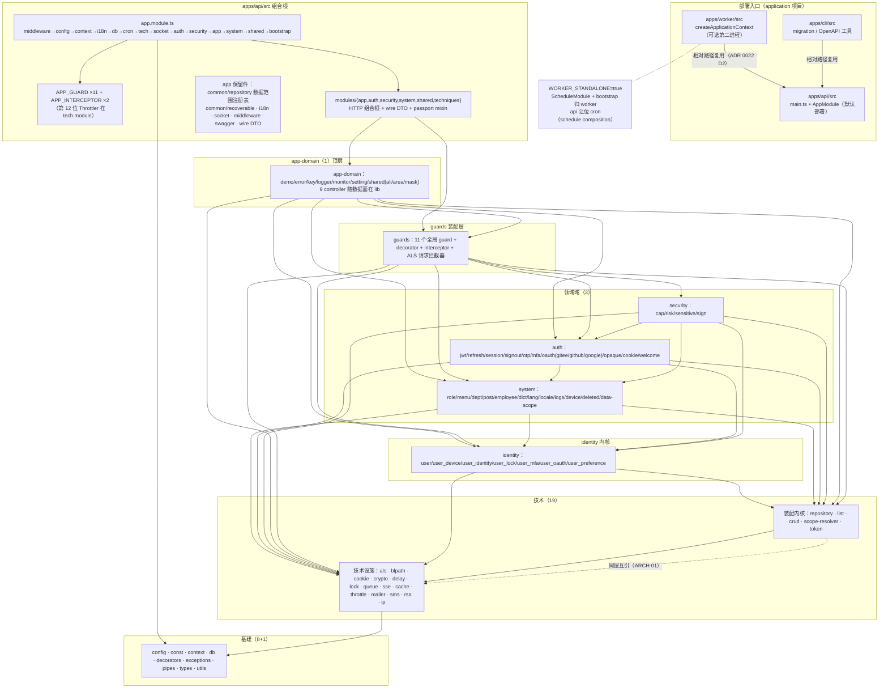

# ARCH — 后端模块构成与引用关系评审报告

- **评审范围**：`apps/server` 内部 Nest monorepo（apps/api + apps/worker + apps/cli + 34 libs），模块地图、分层边界、引用健康度、架构层问题。
- **评审方式**：只读静态调研。判据文件：`apps/server/AGENTS.md`、`apps/docs/src/zh-CN/content/backend/{architecture,dto,transactions,configuration,code-style}.md`、ADR 0022。机械验证：全量 import 扫描（libs 899 个 ts 文件）、ESLint RuleTester 在内存实证 banned 通配语义、madge --circular 实跑（只读，无环）、五处注册面对账复核。
- **结论摘要**：ADR 0022 声明的分层与组合根形态**与磁盘实际一致**：无向上层间依赖、无循环依赖（madge 899 文件）、五处注册面与 34 个 lib 全等、两处交错点仍成立、token 绑定全部跟随实现所在层、forFeature 连接名 39/39 显式、wire DTO 零 lib 反向依赖。未发现 P0/P1。发现 3 个 P2、8 个 P3，另有 5 项待用户裁决。

---

## 1. 模块地图

### 1.1 组合根装配顺序（`apps/api/src/app/app.module.ts:24-63`）

imports 顺序即装配顺序（ADR 0022 Decision 4「app 保留件清单」第 1 条）：

| 序 | imports | 作用 |
|----|---------|------|
| 1 | `AppMiddlewareModule` | 18 个中间件按序 forRoutes('*')（`middleware/middleware.module.ts:20-58`：Favicon→I18n→Id→Version→Timezone→Language→Ip→UserAgent→BlacklistPath→XSS→CSP→Session→CookieParser→Fingerprint→Cors→Compression→Helmet→ResponseTime→Logger） |
| 2 | `WalnutConfigModule` | libs/config（env 唯一注册口） |
| 3 | `WalnutContextModule` | libs/context（requestId 日志 ALS，@Global） |
| 4 | `AppI18nModule` | nestjs-i18n 装配（`i18n/i18n.module.ts:14-33`） |
| 5 | `WalnutModule` | libs/db（TypeORM PG 连接 + tx 基座） |
| 6 | `AppScheduleModule` | cron 归属条件装配：`WORKER_STANDALONE==='true'` 时不注册 `ScheduleModule.forRoot()`（`app/schedule.composition.ts:24-26,50-52`） |
| 7 | `AppTechModule` | 技术设施组合（cache/redis/cookie/crypto/event/health/lock/queue/sse/task/throttler）+ 第 12 位 Throttler APP_GUARD（`tech.module.ts:30-37`） |
| 8 | `SocketModule` | @Global；首个 import `AppMonitorUserHttpModule`（交错点 1，`socket.module.ts:15`） |
| 9 | `AuthModule` | `SysAuthModule`（lib 数据面）+ `AuthHttpModule`（9 controller + 6 passport mixin guard） |
| 10 | `SecurityModule` | `SysSecurityModule` + 4 controller（rsa→sign→cap→sensitive） |
| 11 | `AppAppModule` | lib `AppDemoModule` → app `SysDeletedHttpModule` → `AppErrorModule` → `AppMonitorModule` → settings/key/logger（交错点 2，`modules/app/app.module.ts:19-30`） |
| 12 | `SystemModule` | DataScopePolicy(@Global) → `SysSystemModule` + `SysSystemHttpModule`（12 controller）→ `SysIdentityModule` + `SysIdentityHttpModule`（9 controller） |
| 13 | `SharedModule` | 聚合根：token→ali→area→ALS→delay→BLPath→ip→mask（`shared.module.ts:18`） |
| 14 | `AppBootstrapTaskModule` | 条件展开：`...(isWorkerStandalone() ? [] : [...])`（`app.module.ts:62`），放末尾以不扰动路由注册顺序 |

全局 providers：11 个 APP_GUARD + 2 个 APP_INTERCEPTOR（`app.module.ts:65-138`），顺序 = AGENTS.md 的 1-11 位；第 12 位 Throttler 在 `tech.module.ts:34-37`。顺序成立依赖「根模块自身 providers 先于 imports 子树注册」的 Nest 初始化序（`AppTechModule` 在 imports 第 7 位但其 APP_GUARD 仍排最后）。

入口（`main.ts`）：探针 raw 路由在 NestFactory.create 之后、listen 之前挂载（`main.ts:79-82`）；全局 ValidationPipe + ClassSerializer(`excludeExtraneousValues: true`，`main.ts:110-136`)；SIGTERM/SIGINT draining 监听在 `enableShutdownHooks()` 之后注册（`main.ts:156-164`）。

### 1.2 worker / cli 复用（ADR 0022 Decision 2，已核实）

- `apps/worker/src/worker.module.ts:4` 经相对路径 `'../../api/src/app/app.module'` 复用 `AppModule`；`worker.module.ts:26-28`：`AppBootstrapTaskModule` 恒加载 + `...(isWorkerStandalone() ? [ScheduleModule.forRoot()] : [])` —— 与 api 侧同一判据，cron 只有一处归属。
- `apps/worker/src/main.ts:21-26`：`createApplicationContext`（无 HTTP）+ `enableShutdownHooks`。
- `apps/cli/src/export-openapi.ts` 相对引 api 的 app.module/swagger.options/logger（离线导出）；`data-source.cli.ts` 供 migration。api 构建以 exclude 挡掉 cli，worker 产物随镜像（infra/nest 全局 filenames）。

### 1.3 模块关系图

### 1.4 分层表格（六层 ↔ 磁盘 34 lib）

| 层（eslint.config.ts:9-18） | lib（磁盘核实） | 数量 | 出边约束（banned） |
|----|----|----|----|
| infra | config, const, context, db, decorators, pipes, types, utils | 8 | 技术+领域+顶层 |
| infra-exceptions | exceptions | 1 | 同 infra，唯一放行 → blpath |
| tech | als, blpath, cookie, crypto, delay, lock, queue, sse, cache, throttle, mailer, sms, rsa, ip, repository, list, crud, scope-resolver, token | 19 | 领域+顶层 |
| identity | identity | 1 | system/auth/security + 顶层 |
| system | system | 1 | auth/security + 顶层 |
| auth | auth | 1 | security + 顶层 |
| security | security | 1 | 顶层（guards/app-domain） |
| guards | guards | 1 | app-domain |
| app-domain | app-domain | 1 | 无 |

app 侧 23 个 Nest module（22 组合根/装配 + worker 1 个 = 全仓 133，与任务口径一致）；controller 47 = app 38 + libs 9，与 ADR 0022 Decision 4「38 个留 app、app-domain 9 个进 lib」**逐字吻合**。

---

## 2. 分层与边界核对（对照 ADR 0022 机械守卫）

### 2.1 ESLint 声明层 ↔ 磁盘一致性 ✅

`eslint.config.ts:9-18` 五份名单（8+1+19+4+2=34）与 `libs/` 磁盘 34 个含 `src/index.ts` 的目录**全等**；`lib-registration.drift.spec.ts:562-711` 把 tsconfig paths、三份 infra/nest json（filenames+projects）、三份 swcrc paths、`apps/api/tsconfig.app.json` include、eslint 名单五处对死，且 `layer()` 接线（调用数=9、banned≡rank 推导）有注入篡改自测（`:698-710`）。**未发现声明层与磁盘不一致**。

### 2.2 漂移门禁实际守住什么、漏什么

| 门禁 | 守住的 | 盲区（本次核实） |
|------|--------|------|
| `lib-registration.drift.spec.ts` | 五处注册面与磁盘全等；lib 漏注册（SWC filenames 漏→运行时解析失败） | application 侧（api/cli/worker）只查形状，不参与 lib 对账（by design，`:611-631`）；configs 里**非 paths/filenames** 的其他键（如 tsConfigPath 指向错误 lib 的 lib 侧 tsconfig 内容）不查内容只查指针 |
| `dto-entity.drift.spec.ts` | DTOBase↔Entity 字段形状、menu 口径快照、枚举三方（DTO↔const↔CHECK）、恢复注册表对账 | 完备性扫描只认 `.dto.ts` 文件 + 类名 `DTOBase` 后缀（`:273-285,296-321`）—— 基座类写进非 .dto.ts 文件或换后缀命名即逃出「注册完备」对账（ARCH-11）；wire 层 Safe/Request DTO 不在对账面（有意，只钉基座） |
| `eslint-data-scope-entities.drift.spec.ts` | nest.ts `direct-repository` 正则实体名 ↔ `WALNUT_DATA_SCOPE_ENTITIES` 注册表恒等（文本级单向） | 只对账该一条规则；基类绕行的其他面（如 em.getRepository 未注册实体）本就不在拦截面 |
| `route-catalog.drift.spec.ts`（补充：除任务点名的 3 个外还有这一个） | controller 字面量路由 ↔ contract/routes.ts 前缀/覆盖/反孤儿/分组域名 | 复合装饰器（WalnutCrudDecorators 生成）的方法路由不进字面量扫描，靠前缀常量兜底（`:718-727`，有自测） |

### 2.3 各盲区逐项验证结果

- **.d.ts type-only 跨层依赖**：分层规则文件 glob `libs/<lib>/**/*.ts` 含 .d.ts，但 .d.ts 无 import 声明（类型位用 TSImportType），规则天然不触发；ADR 0022:46-48 已声明此盲区靠评审。抽查 `libs/auth/src/modules/signout/types.d.ts`（import `@walnut-server/const/app/setting`）、`libs/security/src/risk/types.d.ts`（const/decorator/logAuth）、`libs/cache/src/types.d.ts`、`libs/types/src/process.d.ts` —— **现有 .d.ts 的 type-only import 全部向下合法**，ADR 的声明当前成立。
- **动态 import()**：`libsGuardConfig`（`eslint.config.ts:90-103`）以 `ImportExpression` selector 全禁。全仓扫描仅 3 处 `import(`：`libs/auth/src/modules/jwt/jwt-access.guard.ts:30` 的 `import('rxjs')` 是 **canActivate 返回类型标注（TSImportType 类型位）**，无运行时依赖边，属规则注释明示的豁免形态；另两处在 drift spec 自身（fs 扫描需要，app 侧测试文件）。**libs 下零运行时动态 import，守卫有效**。
- **相对路径跨 lib 逃逸**：`local/no-cross-lib-relative-import` 对 libs/** 生效；本次全量扫描 libs 内相对 import 解析目标均在本 lib 内，**零逃逸**。app 侧相对路径不受该规则管，实际仅存在两类：组合根内部装配（app.module.ts 等）与 worker/cli 对 api 的复用（ADR Decision 2 认可），**未发现 app→libs 相对路径逃逸**。
- **子路径 banned 通配**：分层 banned 形如 `group: ['@walnut-server/<lib>', '@walnut-server/<lib>/*']`（`eslint.config.ts:41-46`）。本仓 `@walnut-server/<lib>/<多段子路径>` 导入是普遍惯例（300+ 处，如 `@walnut-server/security/cap/cap.service`）。**用项目自身 eslint 以 RuleTester 实测**：`@walnut-server/guards/decorators/cache.decorator` 与 `@walnut-server/guards/guards/risk.service` 均被 `@walnut-server/guards/*` **拦截**（ESLint no-restricted-imports 遵循 gitignore 语义，`*` 虽不跨 `/`，但父目录前缀命中即整棵子树命中）。**该盲区不存在**——子路径导入同样受分层约束。`@/*` 与 `**/apps/**` 两条禁令亦实测有效。
- **app 与 lib 反向依赖**：libs 内 `from '@/'` 全量扫描 **0 处**；wire DTO（`SysUserDTOSafe`/`WalnutAdminVirtualUserDTO`）在 libs 中仅出现于注释（7 处，均属解释性注释，如 `libs/app-domain/src/monitor/user/dto/user.dto.ts:9-10`、`libs/auth/src/auth.module.ts:26`），**零代码依赖**。
- **wire DTO 与 controller 落位（Decision 4 app 保留件清单）**：✅ 逐项吻合——wire DTO 在 app（`modules/system/user/dto/user.dto.ts`、`modules/auth/modules/opaque/dto/`、`common/model/virtual/{user,device}.ts`）；数据范围注册表+policy 在 app（`common/repository/data-scope.ts:75-165` 8 个注册实体 + 逐条豁免理由 + junction 说明）；event/health/logger/task 四件在 `modules/techniques`；`APP_FILTER` 跟随数据面进 lib（`libs/app-domain/src/error/error.module.ts` providers 含 `APP_FILTER`，符合 ADR 0022:176-178 的判据）；11 APP_GUARD + 2 APP_INTERCEPTOR + `EventEmitterModule.forRoot()` 留 app。
- **两处交错点**：✅ 均仍成立——① `SocketModule` 首个 import `AppMonitorUserHttpModule`（`socket.module.ts:2,15`，注释即 ADR 原文）；② `AppAppModule` 中 `AppDemoModule → SysDeletedHttpModule → AppErrorModule`（`modules/app/app.module.ts:19-30`）。

---

## 3. 模块间引用健康度

### 3.1 跨域 import 密度表（全量 import 语句扫描；列 = 被引方）

| 源 ↓ 被引 → | identity | system | auth | security | guards | app-domain | 装配内核(5) | 技术设施(14) | 基建 |
|------|----|----|----|----|----|----|----|----|----|
| app-domain | 9 | 7 | 3 | 0 | **10** | — | 31 | 12 | 73 |
| guards | 1 | 4 | 1 | **10** | — | — | 5 | 30 | 63 |
| security | 5 | 3 | 4 | — | — | — | 1 | 24 | 18 |
| auth | **27** | 5 | — | — | — | — | 6 | 34 | 50 |
| system | **26** | — | — | — | — | — | 28 | 16 | 155 |
| identity | — | — | — | — | — | — | 12 | 15 | 62 |
| 装配内核(5) | — | — | — | — | — | — | 8（同层） | 12 | 22 |

全部边向下合法（无一条 rank(target) < rank(source) 的上引；exceptions→blpath 为登记例外）。密度特征：`system→identity 26` 与 `auth→identity 27` 证明 identity 内核定位成立（被两域共同消费）；`guards→security 10` 集中在 risk/sensitive/sign/cap guard 对 security 服务的装配依赖，方向正确。

### 3.2 barrel export 面

| lib | 形态 | 规模 |
|-----|------|------|
| auth | **61 个 export ***（90 行 barrel） | 全量倒出 module/service/dto/strategy |
| guards | 31 个 export *（52 行） | decorator/guard/interceptor 全量 |
| security | 25 个 export *（41 行） | cap/risk/sensitive/sign 全量 |
| identity / system / exceptions | 13 / 15 / 12 个 export * | 按子域目录全量 |
| app-domain | 7 个 export *（demo/error/key/logger/monitor/setting/shared） | 按域聚合 |
| 其余 26 个 lib | 2-23 个具名 export，无 export * | 收敛 |

ADR 0022:183-185 明确 lib barrel 的 `export *` 是内部消费口径、不受 ADR 0013 约束 —— 形态本身合规（ARCH-08 讨论代价）。

### 3.3 循环依赖 ✅

`madge --circular --ts-config tsconfig.json apps/api/src libs --extensions ts` 实跑（apps/server，899 文件）：**No circular dependency found**（18 个 import 解析 warning，均为 spec/类型文件噪声）。基建层内部（config→const/utils、decorators→pipes/utils、pipes→exceptions、utils→const）为同层单向边，与 ADR 0022:192-195「纯判定放最低叶子」的结构约束描述一致。

### 3.4 @Global 模块清单与评估（全仓 42 个）

构成：repo 模块 17（符合 AGENTS「Repo Service @Global」约定）· shared 模块 4（device/logAuth/otp/monitor-user）· 技术设施 9（cache/redis/cookie/crypto/delay/blpath/ip/als/token）· 领域 7（mfa/session/signout/risk/sensitive/rsa/data-scope）· app 5（key/mask/context/data-scope-policy/socket）。

- **合理（有结构性理由）**：`SocketModule` @Global 是交错点 1 的配套——SocketModule import 了 AppMonitorUserHttpModule，若 monitor user 侧反过来 import SocketModule 即成环，@Global 断环（`socket.module.ts:13` + `apps/api/src/modules/app/monitor/user/shared/user.shared.module.ts:14` 注释）；repo 模块与 `WalnutAdminDataScopePolicyModule`（token 绑定宿主）按约定。
- **冗余候选**：`SharedMaskModule` @Global（`libs/app-domain/src/shared/mask/mask.module.ts:3`）但唯一消费方 `AppErrorModule` 已显式 import 它（`libs/app-domain/src/error/error.module.ts:35`）——@Global 纯属多余（ARCH-02）。

### 3.5 注入 token 反转（Decision 3 核对）✅

19 个 `WALNUT_ADMIN_*` token 的声明/绑定全量核对（`provide:` 在 port 文件注释里的示例文本已剔除，实际绑定全部在 @Global 模块文件）：

| token | 端口声明 | 绑定位置 | 判定 |
|------|------|------|------|
| IDENTITY_×7（USER_NOTIFIER/DEVICE_SERVICE/OTP_SERVICE/MFA_POST_VERIFICATION/SIGNOUT_SERVICE/MONITOR_REPOSITORY/DATA_SCOPE_INVALIDATOR） | libs/identity/src/identity.ports.ts | app monitor shared ×1、auth ×2、system ×3、app-domain ×1 | ✅ 均在实现所在层或更高 |
| AUTH_RISK_SERVICE / AUTH_MONITOR_SERVICE | libs/auth/src/auth.ports.ts | security/risk ×1、app monitor shared ×1 | ✅ |
| SYSTEM_FAILED_LOGIN_RISK_COLLECTOR / SYSTEM_MONITOR_ACTIVE_USER_READER | libs/system/src/system.ports.ts | security/risk、app-domain monitor repo | ✅ |
| BLACKLIST_REPOSITORY | libs/ip/src/ip.ports.ts | app-domain setting repo | ✅（实现随 setting 域在 app-domain） |
| DATA_SCOPE_POLICY | libs/repository/src/ports/data-scope.port.ts | **app** common/repository/data-scope.policy.module（实现依赖 app 实体注册表） | ✅ 符合「仅当实现依赖 app 专属能力时落 app」 |
| ERROR_REPORTER | libs/exceptions/src/error-reporter.port.ts | app-domain/error | ✅ |
| IP_LOCATION_RESOLVER | libs/crud/src/operate-log/operate-log.ports.ts | libs/ip | ✅（token 放需要它的 crud，实现方 ip 反向引 token——Decision 3「token 放进需要它的 lib」的字面执行，代价见 ARCH-01） |
| KEY_STORE | libs/rsa/src/rsa.ports.ts | app-domain/key | ✅ |
| OPERATE_LOG_WRITER | libs/crud/src/operate-log/operate-log.ports.ts | system/log-operate repo | ✅ |
| SOFT_DELETE_STRATEGY | libs/repository/src/ports/soft-delete.port.ts | system/deleted repo | ✅ |
| TOKEN_TTL | libs/cache/src/token-ttl.port.ts | libs/token | ✅ |

另有 2 个既有 token（`WALNUT_ADMIN_OTP_STRATEGY`、`WALNUT_ADMIN_PERMANENT_BLACKLIST_PATHS`）属 ADR 所说「此前已存在的端口」，不在 19 个之列，口径一致。

### 3.6 TypeOrmModule.forFeature × WalnutPGConnectionName ✅

全仓 39 处 `TypeOrmModule.forFeature(...)` **全部**显式传 `WalnutPGConnectionName`，0 处缺省（不会落 TypeORM 默认连接）；`@InjectDataSource(WalnutPGConnectionName)` 47 处同样全带连接名。

### 3.7 配置装配一致性 ✅（1 处例外）

libs 中 `process.env` 直读仅存在于：`libs/config/src/modules/*`（config 注册面，应当）与 `libs/const/src/app/env.ts:31-40`（ADR 0022 指定的最低叶子，`config/utils/env.ts` 已改为兼容转发）。其余 15 个 lib 一律经 ConfigService 读配置。唯一例外见 ARCH-04。

---

## 4. ARCH-* 问题清单

> 优先级定义：P0 正确性/安全/数据丢失；P1 明确缺陷或架构违例；P2 质量/可维护性；P3 轻微/风格。本次未发现 P0/P1。

### ARCH-01（P2）技术层 19 个 lib 内部互引无机械守卫，且已长出「装配内核方向」的纵向边

- **证据**：
  - `libs/ip/src/ip.module.ts:3`：`import { WALNUT_ADMIN_IP_LOCATION_RESOLVER } from '@walnut-server/crud'`；`libs/ip/src/ip.service.ts:1,10`（引 crud/list）——「技术设施」依赖「跨域装配内核」；
  - `libs/repository/src/pg-base.repository.ts:5,13`、`libs/repository/src/pg-list.builder.ts:1`（repository→als/list）；`libs/crud/src/list.ts:5`、`libs/crud/src/operate-log/operate-log.decorator.ts:5,13`（crud→list/als/cookie）；`libs/token/src/token.service.ts:1`（token→cache）；`libs/sms/src/sms.processor.ts:3,7`、`libs/mailer`（→queue/cache）；`libs/rsa`（→cache）；
  - 分层规则按 8 个粗层接线（`eslint.config.ts:108-117`），同层互引完全不在 banned 集合内；ADR 0022:194-195 只对基建层声明了「同层环靠结构约束」，技术层 19 lib 的同层环无人看守。
- **问题**：技术层把「纯技术设施」（delay/sse…）与「跨域装配内核」（repository/list/crud/scope-resolver/token）压成一层，二者抽象层级差一个量级；现在已有 ip→crud、token→cache 这类「设施依赖内核」的边，若未来 crud/repository 反过来引 ip/cache，会立刻成环且没有任何门禁变红（madge 只在事后发现）。
- **影响**：同层环风险不可机械拦截；新 lib 归层时看不出应放「设施」还是「内核」。
- **修复建议**：将技术层拆为 tech-base（设施 14）与 tech-assemble（内核 5）两条 layer（banned 按 rank 推导自动收紧）；或至少用 dependency-cruiser/ESLint 边清单对这 19 个 lib 声明允许边。ip→crud 的边若不想拆层，可把 `WALNUT_ADMIN_IP_LOCATION_RESOLVER` token 移到 libs/ip（token 换位后 crud 引 ip，方向变正）——是否换位属设计取舍，见待裁决。
- **置信度**：高（互引事实与守卫空白均为机械核实）。

### ARCH-02（P2）@Global 面过宽：42 个全局模块中存在无跨模块消费必要的冗余注册

- **证据**：全仓 `@Global()` 42 处（清单见 §3.4）；`libs/app-domain/src/shared/mask/mask.module.ts:3` @Global，但其唯一注入方 `AppErrorService` 所在模块已显式 import（`libs/app-domain/src/error/error.module.ts:35`），全仓无第三消费方（grep 全仓仅 error.service/error.module/shared.module 三处引用）。
- **问题**：@Global 使 provider 绕过模块 import 图全局可见，mask 这种「单消费方 DI 壳」挂 @Global 会让依赖关系在模块图上不可见；同类形态还有 `SharedDelayModule`/`SharedBLPathModule` 等技术壳（消费面未逐一核实，仅 mask 有实证）。
- **影响**：依赖可见性下降、模块图失真；新成员无法从 import 关系判断谁真正消费 mask。
- **修复建议**：给 @Global 定一条机械可查的准入口径（如「消费方 ≥2 个模块」或白名单），先把 `SharedMaskModule` 的 @Global 摘掉（行为零变化——error.module 已显式 import）。
- **置信度**：mask 冗余=高；整体 42 个的过度程度=中（17 个 repo 模块系约定内）。

### ARCH-03（P2）libs 内 7 处裸 console.error 绕过统一日志管道

- **证据**（均非 spec 文件）：`libs/cache/src/cache.config.service.ts` `console.error('Connection Error', err)`；`libs/delay/src/delay.service.ts` catch 分支 `console.error(e)`；`libs/ip/src/ip.service.ts` 两处 `console.error('baidu ... error', ...)`；`libs/utils/src/headers.ts`、`libs/utils/src/pkg.ts` `console.error('package.json read error:', error)`。
- **问题**：后端日志约定走 `WalnutAdminLogger`（Winston，轮转 + ALS requestId 上下文，`apps/api/src/modules/techniques/logger`）；上述 console 输出不进轮转、无请求上下文、无 Logger 序列化。部分位置（pkg 模块求值期）确有「Logger 未就绪」的理由，但 cache/delay/ip 是运行期服务，同文件已经注入了 Nest `Logger`（如 als/ip service 均 import 了 Logger）。
- **影响**：第三方依赖故障（百度 IP 服务、Redis 连接）在排障时最需要栈与上下文，恰恰从日志管道漏走。
- **修复建议**：这 5 个文件改用已注入的 `Logger`；`utils/pkg` 若确在模块求值期，注释说明保留理由。
- **置信度**：高。

### ARCH-04（P3）error.service 直读 process.env.NODE_ENV，绕过 const 叶子

- **证据**：`libs/app-domain/src/error/error.service.ts:67` `env: process.env.NODE_ENV`；约定叶子 `libs/const/src/app/env.ts:40` `export const WalnutAdminEnv = process.env.NODE_ENV`（`libs/config/src/utils/env.ts` 已是兼容转发）。同文件 DTO 已 import `@walnut-server/const/app/env`（`libs/app-domain/src/error/error.dto.ts`）。
- **问题/影响**：ADR 0022 W3 批把纯 env 判定收敛到 const 叶子（消除 const↔config↔utils SCC），此处是收敛后新长出的直读点；行为无差但破坏「单一落点」约定。
- **修复建议**：改 `env: WalnutAdminEnv`。
- **置信度**：高。

### ARCH-05（P3）lib 数据面出现第 4 形态：裸 `*.service.ts` 直持 DataSource 做数据访问，与「三种 Repository 模式」口径漂移

- **证据**：`libs/identity/src/user_preference/services/user_preference.service.ts:17-44`（头注释自述「本模块无独立仓库，服务即数据面……服务直持 DataSource 即承接」，实现 `getRepository` + QueryBuilder upsert）；`libs/system/src/device/device.service.ts`（`em.getRepository(SysDeviceEntity)`）；对照 AGENTS.md「三种 Repository 模式」（仅 basic.repository / repo/*.repo.service / shared/*.shared.service 三形态）。
- **问题**：B1/B7b 迁移定案的「原先无 repo 的模块随迁移补数据面」以注释形式记录在案，但常驻指引（AGENTS 三种模式表、architecture.md 模块骨架）未登记该形态——评审者按文档走会把它当违例，或反过来误以为 service 可自由持 DataSource。
- **影响**：约定与现实的判据文档不一致，硬规矩（service 不触数据层）的边界模糊。
- **修复建议**：在 AGENTS.md 三种模式表补一行「模块内数据面 service（历史迁移形态，须头注释声明）」，或反向把这些模块补齐 basic.repository。取舍见待裁决。
- **置信度**：高（事实）；处置方式待裁决。

### ARCH-06（P3）三套 AsyncLocalStorage 分属三库，新上下文字段无唯一落点

- **证据**：`libs/als/src/request.service.ts:19`（请求/数据权限/RLS 上下文）；`libs/context/src/logger-context.als.ts:17`（requestId 日志上下文）；`libs/db/src/db.hook.ts`（事务 after-commit 钩子存储）。
- **问题**：三者生命周期确不同（日志跨进程形态、请求域、事务域），但语义上有重叠带（requestId 其实也是请求上下文的一个字段），新人加字段时需要先理解三个 store 的边界；als 与 context 两个 @Global 模块能力相近。
- **影响**：可维护性；无正确性风险。
- **修复建议**：在两库头注释互相指路，明确分工判据（「要进日志行的放 context，进数据权限/RLS 的放 als」）。
- **置信度**：中（可能是有意拆分）。

### ARCH-07（P3）组合根跨目录 import 混用相对路径与 `@` 别名

- **证据**：`apps/api/src/app/app.module.ts:10-22` 全部 `../i18n/i18n.module` 形态相对路径；同仓 `apps/api/src/socket/socket.module.ts:2` 用 `from '@/modules/app/monitor/user/user-http.module'`。code-style.md 只允许「同一模块内部」用相对路径。
- **影响**：风格不统一；组合根文件移动时脆弱。
- **修复建议**：app.module.ts 与各域组合根统一 `@/` 别名（worker/cli 的跨 app 相对路径是 Decision 2 认可的，不在其列）。
- **置信度**：高。

### ARCH-08（P3）宽 barrel 是有意口径，但使「内部改名 = barrel 破坏性变更」且死代码检测失效

- **证据**：`libs/auth/src/index.ts` 90 行 61 个 `export *`（module/service/dto/strategy 全量）；guards 31、security 25；ADR 0022:183-185 明示不受 ADR 0013 约束。
- **影响**：lib 内部任何文件改名/移动都会经 barrel 波及全部消费方（类型层面编译期可见，运行时无感）；knip 对 lib export 面无效（仓库 knip 本就长期红）。当前形态消费方规整（实测子路径+根别名混用），风险可接受。
- **修复建议**：维持现状，但在 ADR 0022 或 code-style 补一句「lib 内部文件移动视同公共 API 变更，openapi:check 与 types:check 为裁判」。
- **置信度**：高（事实），风险评级低。

### ARCH-09（P3）ALSRequestService.set/get 每次调用打两行 debug 日志（含 JSON.stringify）

- **证据**：`libs/als/src/request.service.ts:55-74` —— set/get 各有 `logger.debug(...store exists...)` + `logger.debug(`${key} after set: ${JSON.stringify(store[key])}`)`，get 侧同样两条。该服务在 ALSRequestInterceptor 与基类数据权限路径上被高频调用。
- **影响**：请求热路径的日志噪音/序列化开销；debug 级在生产虽不输出，但 `JSON.stringify` 在参数求值时已发生（Nest Logger.debug 即使级别关闭，参数仍先构造）。
- **修复建议**：删去调试日志或改惰性（`if (logger.debug.isLevelEnabled)` 形态/去 stringify）。
- **置信度**：高（代码事实）；性能影响程度未测量（不主张量化收益）。

### ARCH-10（P3）health controller 直注 DataSource 探活，属「controller 不触数据层」的未登记例外

- **证据**：`apps/api/src/modules/techniques/health/health.controller.ts` `@InjectDataSource(...)`（全仓 47 处 InjectDataSource 唯一落在 controller 的例外，其余全部在 repository/repo service/tx 基座/数据面 service）；AGENTS.md 硬规矩「controller 级的 *.service.ts 不许直接做数据访问（自己注入 DataSource 拿 Repository 也算）」。
- **问题**：探活 SELECT 1 是运维面而非业务数据面，实质无害，但字面上撞线且 AGENTS 未列此例外。
- **修复建议**：在 AGENTS 硬规矩处补一句「health 探针除外」（与 ADR 0022「health 是运行时可观测面」呼应），或把探活腿下沉到一个极小的 probe service。
- **置信度**：高（事实）；是否豁免待裁决。

### ARCH-11（P3）dto-entity drift 的完备性扫描面有窄口：只认 `.dto.ts` 文件 + `*DTOBase` 类名

- **证据**：`apps/api/src/common/dto/dto-entity.drift.spec.ts:273-285`（`listDtoFiles` 仅收 `.dto.ts`）与 `:314`（`value.name.endsWith('DTOBase')`）。已登记条目的形状对账不受影响；漏网情形是「基座类定义在非 .dto.ts 文件」或「基座命名不带 DTOBase 后缀」——这类类不进完备性差集，其 DTO↔Entity 漂移不被守。
- **影响**：低（现有 23 个基座全部在 .dto.ts 且命名规范；风险在未来新代码照抄错形态）。
- **修复建议**：扫描面放宽到全 lib `*Base` 类名或加一条「DTO 基座必须住 .dto.ts 且以 DTOBase 结尾」的 lint selector，把窄口变成显式约束。
- **置信度**：高（对扫描面事实）；实际触发概率低。

---

## 5. 待用户裁决

1. **ARCH-01 拆层还是收边**：技术层拆 tech-base / tech-assemble 两条 layer（改 `eslint.config.ts` + `lib-registration.drift.spec.ts` 的 LAYER_MATRIX），或仅加边清单；`WALNUT_ADMIN_IP_LOCATION_RESOLVER` token 是否从 crud 迁回 ip（迁移会让「token 放在需要它的 lib」的 Decision 3 口径需要补一句例外说明）。
2. **ARCH-05 / ARCH-10 文档口径**：「模块内数据面 service」是否收编进 AGENTS 三种模式表；health 探针是否登记为例外。两处都属常驻指引改动（有字数预算门禁）。
3. **ARCH-02 @Global 准入口径**：是否定「消费方 ≥2 模块才 @Global」的机械判据并立即摘除 mask（行为零变化）；还是维持现状仅记录。
4. **ARCH-06 ALS 合并**：als 与 context 两库是否合并为单一上下文库（牵动 @Global 面与 db.hook 归属），还是仅补分工注释。
5. **文档表述**：`apps/docs/src/zh-CN/content/backend/architecture.md:52` 目录结构图把 guards 画进「技术 / 装配（20）」组，而 eslint/ADR 0022 把 guards 归顶层装配层（TOP_LIBS，依赖序在领域域之上）——两处口径建议统一为 ADR 的六层表述（正文已有注解，但图示分组易误读）。

## 附录：验证方法

- 全量 import 扫描脚本：遍历 `apps/server/libs/**` + `apps/server/apps/**` 的 .ts（含 .d.ts）解析 import 规范符，构建 34×34 lib 邻接表并按 rank 判向；`provide:` 绑定清单已剔除注释中的示例文本（port 文件头注释含 `{ provide: TOKEN, useExisting: ... }` 字样，属文档不是绑定）。
- ESLint 通配语义实证：以 `apps/server/node_modules/eslint` 的 Linter 在内存中对 banned group 形态跑 4 组 import 样本 + COMMON_IMPORT_PATTERNS 5 组样本（无文件写入）。
- madge：`node node_modules/madge/bin/cli.js --circular --ts-config tsconfig.json apps/api/src libs --extensions ts`（cwd=apps/server，≈7s，899 文件）。
- 交错点、worker 条件装配、token 绑定、forFeature 连接名：逐一读源核实，行号见正文。
- 本报告为只读评审，未修改任何源码/文档；`apps/docs/src/zh-CN/content/review/backend/architecture.md` 为唯一新增产物。
