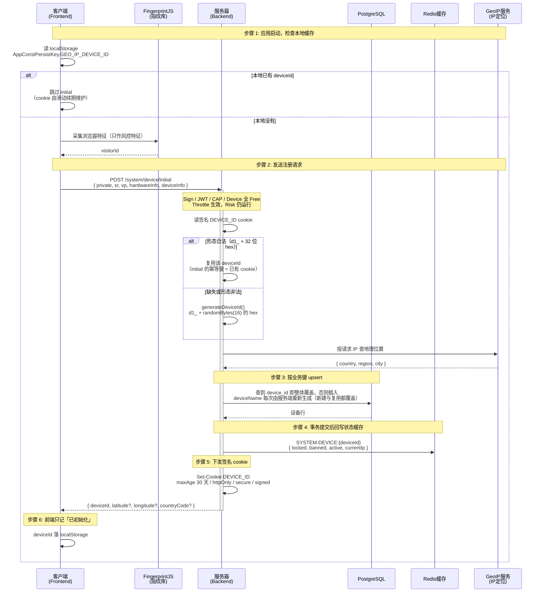
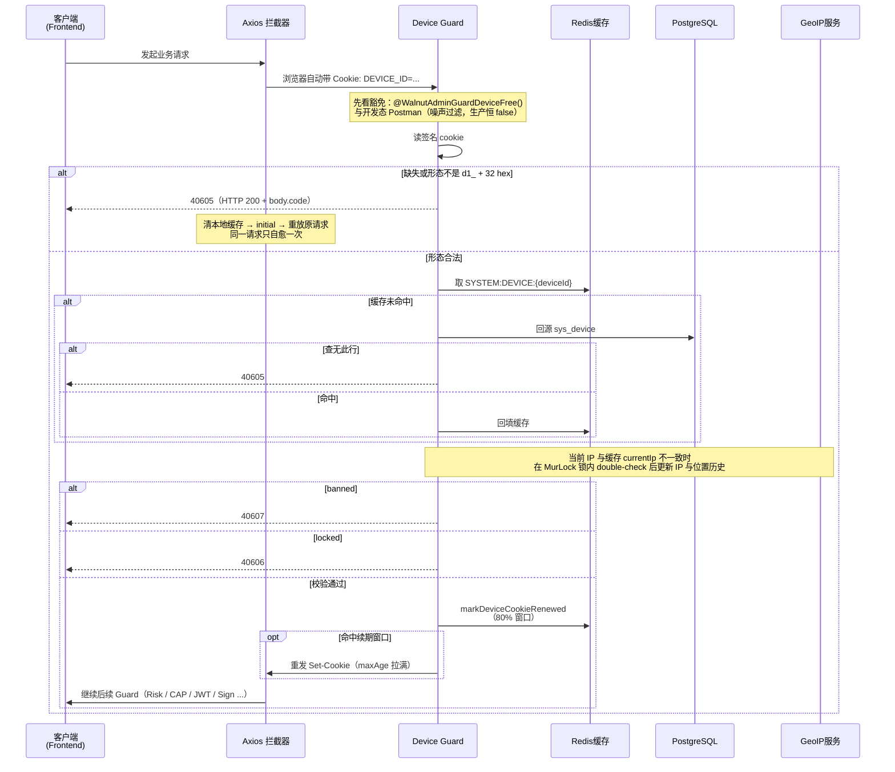

# <WPageTitle></WPageTitle>

:::warning
- 由claude生成
:::

## 介绍

现代 Web 应用里，设备标识（Device ID）是安全防护、会话管理与风控的公共地基。Walnut Admin 的
设备身份**由服务端随机签发**：浏览器指纹只作为风控特征，**不参与身份派生**。

核心设计（判据都在代码里，本文只解释「为什么这样」）：

1. **服务端签发**：`POST /system/device/initial` 用 `randomBytes` 生成 `d1_` + 32 位小写
   hex（16 字节 = 128 bit 熵）。客户端没有签发入口 —— 「不可伪造」的来源是**签发权在服务端**，
   不是哈希。改造前它是「客户端自报指纹的确定性函数」（HMAC-SHA256），谁拿到别人的指纹就能铸出
   别人的设备身份；那道口子已经关掉。
2. **形态判据唯一**：合法值只有一种形态，判据在 `apps/server/libs/const/src/app/device.ts` 的
   `isValidDeviceId`（正则 + 前缀常量）。cookie 读取与 initial 的复用判定都调它；数据库侧另有
   同形态的 CHECK 兜底（SQL 里必然复制一份正则）。显式前缀是关键：旧形态恰好是裸 64 位 hex，
   只按长度 / 字符集判别必然混淆，只有前缀能让「旧值」与「伪造值」在**一处**被同一个判据拒掉。
3. **Cookie 承载身份**：签名 cookie `WalnutAdminConstCookieKeys.DEVICE_ID` 是身份的传递通道。
   initial 的**幂等键是「已有的合法 cookie」** —— cookie 里已是合法签发值就复用它，否则签一个
   新的。这条取代了改造前的「同指纹即同设备」。
4. **滑动续期 + 留存清理**：cookie 有效期 30 天，但每次校验命中后按**有效期的 80% 窗口**重发
   （剩余寿命恒大于 20%，永远走不到 0）；设备行另有 90 天留存清理。两者是不同层的两件事，见
   「有效期、滑动续期与留存」。
5. **<WBaseLink preset="redis">Redis</WBaseLink> 多维度关联**：Device ID 是缓存键的组成部分，
   关联 RSA 公钥、AES 会话密钥、CAP 校验缓存、会话与权限数据。
6. **设备状态管理**：锁定 / 封禁 / 活跃状态追踪，以及 IP 变更检测。

需要说明的是：

- 设备身份是整个安全体系的基石：签名握手、CAP 校验、会话管理都以它为键
- 浏览器指纹仍会被采集，但只用于风控特征与心跳的归属校验 —— 它不是身份，也不提供跨浏览器关联
- 清 cookie / 换浏览器 / 换隐私窗口 = **新**设备身份。这是有意的产品口径（服务端不试图把同一台
  物理设备的多个浏览器关联起来），不是缺口

下文说明身份形态与自愈、注册与校验流程、续期与留存，以及它与其他子系统的协作。

## 相关链接

- [体验地址](https://www.walnut-admin.com/)

## 关键影响维度说明

### 1. Visitor ID（浏览器指纹）

`Visitor ID` 是 <WBaseLink preset="fingerprintjs">FingerprintJS</WBaseLink> 等指纹库生成的浏览器
特征摘要（硬件信息、屏幕、Canvas / WebGL / 音频特征等）。

- **不参与身份派生**：它既不进 `POST /system/device/initial` 的请求体，也不是 `device_id` 的
  输入 —— 客户端自报的值影响不了自己的身份。
- **只作风控特征**：设备 / 位置 / 频率等维度的评分会参考它；指纹漂移本身**不**触发重新初始化。
- **心跳的归属校验**：`POST /app/monitor/user/state` 的 `visitorId` 只与「本设备已存的那一行」
  比对，不一致即受控 `40099` 且不写库；首次上报以请求里的值登记。

### 2. Device ID（设备标识）

`Device ID` 是服务端签发的设备唯一标识：

- **形态**：`d1_` + 32 位小写 hex（前缀常量 `WALNUT_DEVICE_ID_PREFIX`，判据 `isValidDeviceId`）
- **签发**：`generateDeviceId()`（`apps/server/libs/system/src/device/device-id.ts`）只调
  `randomBytes(16)`，**不碰任何密钥**
- **签发点**：只有 `POST /system/device/initial` 一处（`apps/server/libs/system/src/device/device.service.ts`
  先读 cookie：形态合法就复用，否则新签）。签发点越少，「谁能决定身份」越好审计
- **存储位置**：签名 cookie（`WalnutAdminConstCookieKeys.DEVICE_ID`）+ 前端 localStorage
  （`AppConstPersistKey.GEO_IP_DEVICE_ID`，只为「已初始化过就别再 initial」）
- **有效期**：cookie 30 天 + 80% 窗口滑动续期；设备行另受 90 天留存清理约束
- **作用范围**：全局 —— 所有需要设备校验的端点都靠这枚 cookie 定位设备

### 3. 设备信息（Device Info）

服务端在 `sys_device` 里保存：

- **设备名**：服务端在**每次** initial 里生成 `<设备类型>_<8 位随机 hex>`（不区分新建还是复用），
  `uq_device_name` 全局唯一。客户端不能提供它 —— initial 的 DTO 里没有这个字段，带上会被全局
  白名单判成 `40099`；撞唯一约束仍收敛为受控 `40000`
- **设备类型**：由 UA 正则（bot / tablet / mobile）与屏幕宽度共同推导
- **设备与硬件信息**：`deviceInfo`（与 `req.os` / `req.browser` 合并）、`hardwareInfo`、
  `sr` / `vp`
- **网络与位置**：当前 `ip` 与 `locationInfo`，外加 `ipHistory` / `locationHistory` 两段等长
  历史（上限写在各 `arrayOptions.maxSize` 里，`updateIpAndLocation` 按同一条规则裁剪 —— 改一处
  就得改两处）
- **状态标识**：`active` / `locked` / `banned` / `stale`

### 4. 设备状态管理

| 标志 | 谁写 | 效果 |
|---|---|---|
| `active` | 心跳与 cron 维护 | 参与「是否在用」的判定（含留存清理） |
| `locked` | `PATCH /system/device/:id/lock` | Device guard 拒 **40606** |
| `banned` | `PATCH /system/device/:id/ban` | Device guard 拒 **40607**；封禁 = 踢下线（同事务撤该设备全部 RT，提交后清会话键并断 WS） |
| `stale` | cron 打标 / initial 清标 | **不参与鉴权**，只表示「残留行」 |

`banned` 先于 `locked` 判定。这两个标志是**落库真值**，缓存只是加速层（缓存未命中会回源库）。
解封 / 解锁不触发任何踢人动作。

## 身份形态与自愈

设备身份坏掉时会发生什么，是最容易被写成旧口径的一段，所以单列一张表：

| 现象 | 成因 | 服务端 | 客户端 |
|---|---|---|---|
| `40605` | cookie 缺失 / 空 / 形态不是 `d1_` + 32 hex（旧裸 64 hex、被改写、伪造） | Device guard 直接拒（`WalnutAdminExceptionDeviceNotAcceptable`） | 清本地 device 缓存 → 重走 `POST /system/device/initial` → **重放原请求**；同一请求只自愈一次，并发经 `SingletonPromise` 收敛，防死循环 |
| `40605` | 形态合法但库里查无此行 | 同上（缓存未命中回源仍查无） | 同上 |
| `40606` / `40607` | 设备被锁定 / 封禁 | 拒，且**不**重发 cookie | 不自愈（这不是自愈得掉的状态），提示联系管理员 |
| `40099` | initial 带了白名单外字段（如 `deviceName`、`visitorId`）；或心跳 `visitorId` 与本设备已存行不一致 | 全局 `ValidationPipe`（`whitelist` + `forbidNonWhitelisted`）/ 业务校验 | 改请求体；这不是身份问题 |

判据与落点：

- 形态判据只有一处：`apps/server/libs/const/src/app/device.ts`
- DB 侧兜底：migration `ck_device_device_id_form`（旧形态写不进去，于是硬切不需要 legacy 列）
- 自愈链只有一条：`apps/server/libs/guards/src/guards/device.guard.ts` 抛 `40605`，
  `apps/admin/src/utils/axios/interceptors/response/device.ts` 重建身份并重放
- 错误码形态：统一响应壳是 **HTTP 200 + `body.code`**（全局异常过滤器恒以 `HttpStatus.OK`
  落盘），所以「40605」是**业务码**，不是 HTTP 状态码 —— 别按 401/403/406 去写客户端分支

## 有效期、滑动续期与留存

三层寿命各不相同，混起来就会写出「30 天到期就要重新初始化」这种错话：

| 对象 | 寿命 | 谁负责 | 到期后果 |
|---|---|---|---|
| `DEVICE_ID` cookie | 30 天 maxAge + **80% 窗口滑动续期** | `apps/server/libs/const/src/app/cookie.ts`（maxAge 与续期间隔同源，改一个另一个跟着变）+ Device guard 校验通过后重发 | 只要有请求经过 Device guard，剩余寿命恒大于 20%，**不会**「第 31 天起全站 40605」 |
| 续期窗口闸 | TTL = 续期间隔，键 `SYSTEM:DEVICE:COOKIE_RENEW:<deviceId>` | `AppTechCacheDeviceService.markDeviceCookieRenewed` | 窗口内的重复请求不会重复 `Set-Cookie` |
| `sys_device` 行 | 90 天留存清理（cron） | `purgeInactiveDevicesBefore`（`apps/server/libs/system/src/device/repo/device.repo.service.ts`） | 见下 |

留存清理的判据是**五条同时满足**：`active = false`；`updated_at` 早于窗口下界；`banned` 与
`locked` 都为 false；没有窗口内的在线访客行，也没有「未撤销且未过期」的 RT。锚点用
`updated_at` 而不是 `stale`（前者在所有写分支上都会推进），`banned` / `locked` 的行**永久
保留** —— 它们是那条管理决定的唯一持久记录，删掉等于静默解封。

窗口天数不在 SQL 里写死：由 cron 算好 `cutoff` 传入（`apps/server/libs/system/src/device/repo/device.pg.purge.service.ts`）。

## 流程图

:::tabs
== 设备注册与身份签发

== 请求校验与滑动续期

:::

## 与其他系统的协作

### Device ID 在签名系统中的作用

Device ID 是签名系统的核心锚点：RSA 公钥（`SECURITY:RSA:PUB_KEY:<deviceId>`）与 AES 会话密钥
（`SECURITY:SIGN:AES_KEY:<deviceId>`）都以它为键。设备身份一变（清 cookie / 换浏览器），签名侧
自然要重新握手一次 —— 那不是「失效」，而是新设备本来就该走的完整流程。

详细的签名流程请参考 [签名验证机制](/content/shared/sign)。

### Device ID 在认证系统中的作用

认证系统里 Device ID 参与这些维度（共用一条「同设备」的语义，不要把它当作用户身份）：

- **会话管理**：会话键含 deviceId（`AUTH:SESSIONS:{userId}:{deviceId}:{sessionId}`），支持按设备
  维度管理 / 撤销会话
- **权限缓存**：权限缓存按 `userId` + `deviceId` 粒度隔离
- **MFA 验证**：验证状态绑定到 `userId` + `deviceId`，换设备要重新验证
- **用户锁定**：登录失败锁定按 `userId` + `deviceId` 粒度，不影响同一用户的其他设备

## 补充说明

### 安全特性

1. **服务端签发** - 设备 id 只由服务端 `randomBytes` 生成，客户端没有签发入口，因此无法「铸出」
   别人的设备身份
2. **形态判据唯一** - 单一正则 + DB CHECK 双保险；旧形态与伪造值走同一条拒绝路径
3. **HttpOnly Cookie** - 身份只存在 HttpOnly 签名 cookie 里，XSS 拿不到
4. **Secure + SameSite** - cookie 恒为 `secure`（生产 `SameSite=None` 以便 OAuth 回调跨站携带，
   开发 / stage 为 `Lax`）
5. **设备状态控制** - 支持远程锁定 / 封禁，封禁是同事务撤 RT + 提交后断连的「踢下线」
6. **IP 变更追踪** - 自动检测并记录 IP 变化，辅助异常行为分析
7. **分布式锁** - IP 更新走 MurLock，防止并发请求重复写入
8. **自愈而非死胡同** - `40605` 可由客户端重建身份后重放，不会把用户永久锁在门外

### 存储策略

| 存储位置 | 内容 | 有效期 | 用途 |
|---------|------|-------|------|
| Cookie（签名） | Device ID | 30 天，80% 窗口滑动续期 | HTTP 请求自动携带 |
| LocalStorage | Device ID | 随本地存储 | 前端「已初始化」标记，避免重复 initial |
| PostgreSQL | 设备详细记录 | 长期；`active = false` 且 90 天无写活动的行会被清理 | 设备信息与状态真值 |
| <WBaseLink preset="redis">Redis</WBaseLink> | 设备状态缓存 | 无限期 | 高频读取场景（未命中回源库） |

### 性能优化

1. **缓存优先** - 设备状态先读 <WBaseLink preset="redis">Redis</WBaseLink>，未命中才回源库并回填
2. **Upsert 语义** - 注册时按业务键 `device_id` 一次完成「查到即整体覆盖 / 否则插入」
3. **MurLock 分布式锁** - IP 变更时用锁 + double-check，防止并发重复写入
4. **历史裁剪** - IP / 位置历史按 `maxSize` 裁剪，不会无限增长
5. **豁免机制** - `@WalnutAdminGuardDeviceFree()` 豁免不需要设备校验的端点（如 initial 本身）
6. **续期窗口闸** - 续期判定走 Redis 时间闸，不必每个请求都重发 cookie

### 局限性

1. **设备身份与指纹解耦** - 同一物理设备的不同浏览器 = 不同设备；同一指纹的多台设备之间**没有**
   任何关联判据（这是有意的产品口径，不是缺口）
2. **指纹漂移的症状是 40099** - 指纹与本设备已存行不一致时，心跳被受控拒绝，而不是「重新初始化」
3. **Cookie 依赖** - 用户禁用 cookie 时设备标识无法工作
4. **重新初始化的真实触发条件** - 清掉 cookie / 换浏览器 / 换隐私窗口；不是「30 天到期」
5. **单设备维度** - 同一浏览器的多个标签页共享同一个 Device ID，无法按标签页区分
6. **封禁是设备级而非用户级** - 同一用户换一台设备仍可登录（除非另有用户级处置）
